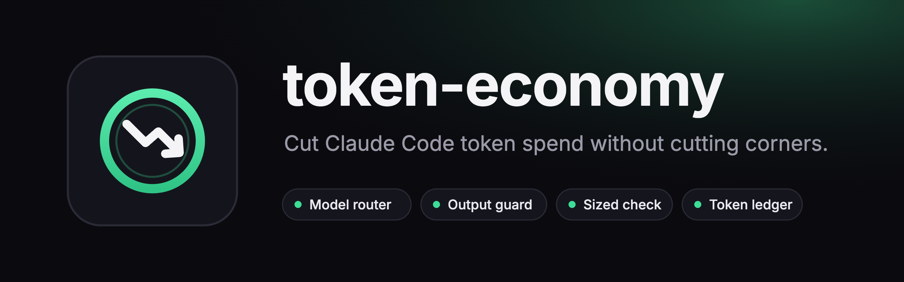
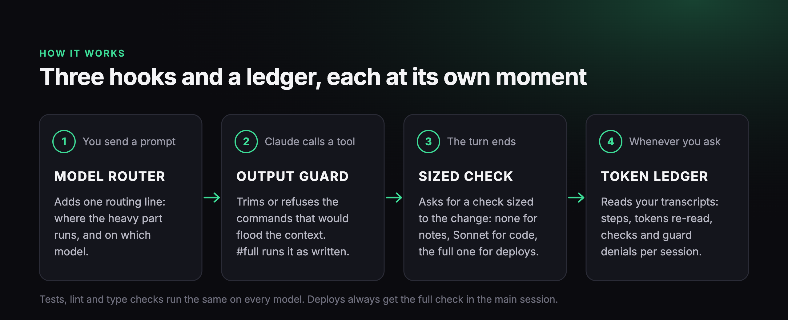

<p align="center">
  
</p>

# token-economy

[](https://code.claude.com/docs/en/plugins)
[](LICENSE)


**Cut Claude Code token spend without cutting corners.** A free plugin that sends each task to the cheapest model that can do it well, keeps huge tool output out of the context, sizes the end-of-turn check to the change, and shows you where your tokens went.

## Quick start

```bash
claude plugin install token-economy --marketplace Jfri3ss/token-economy
```

Then start a new Claude Code session. That's it: the hooks are on, with no config needed.

On Claude Code older than 2.1.292, add the marketplace first:

```bash
claude plugin marketplace add Jfri3ss/token-economy
claude plugin install token-economy@emmber
```

**What you'll see.** Each prompt gets one line of routing context, for example:

```text
Routing: read-only task. Delegate the reading to ONE Agent on haiku with a narrow brief,
and relay its answer. Do not read the files in this context.
```

A command that would flood the context gets refused with the smaller form to use instead. A plain `git log` or listing inside the project is trimmed for you instead (`-n 20`, `| head -50`), which saves the extra round trip:

```text
git diff with no path can be thousands of lines. Run it with --stat first,
then diff the paths you need (git diff -- path), or add #full.
```

And to see where your tokens went:

```bash
python3 "$(ls -d ~/.claude/plugins/cache/emmber/token-economy/*/ | tail -1)scripts/token-ledger.py" --last 8
```

## What's inside

<p align="center">
  
</p>

- **Model router.** Classifies every prompt as a question, a read, a routine edit, a build or a hard task, and tells the session where the heavy part should run. A top model spends its limit on judgment; Sonnet and Haiku do the reading, testing and typing. It also refuses an Agent call whose model doesn't fit its brief.
- **Output guard.** Refuses the few command shapes that dump thousands of lines into the context (whole-file reads, bare `git diff`, untailed test runs, long listings) and names the smaller form. Add `#full` to any command to run it as written.
- **Sized end-of-turn check.** A Stop hook that asks the session to check its own work, sized to what changed: nothing for a doc edit, a Sonnet subagent for code, the full check in the main session for a deploy.
- **Token ledger.** Reads your session transcripts and shows steps, tokens re-read, context size, check runs, guard denials and overrides per session. `--compare YYYY-MM-DD` shows before and after a date, per step.
- **Optional free account.** `scripts/account.py login` gives you a dashboard of your usage over time, across machines. Uploads are off until you turn them on, and only daily counts are sent: see [PRIVACY.md](PRIVACY.md). The plugin works the same without it.

## Why it works

Measured over a week of real sessions on one project (329 sessions, 19–26 October 2026), the cost was not tool output. It was **model steps multiplied by context size**: every step re-sends the whole conversation, so a session that grows to 800K tokens of context pays that on every one of its steps. The biggest session ran 985 steps and re-read 506 million tokens; the whole week re-read 4.4 billion. Tool output over the same week was 116 MB, about 30 million tokens, well under 1% of that.

So the levers are, in order: fewer and shorter sessions, fewer steps per turn, a smaller fixed context, and keeping work that doesn't need the top model off it. This plugin automates the last three. The first is a habit: start a fresh session per task, and watch the ledger's context column.

**Accuracy doesn't drop.** Tests, lint and type checks run the same whichever model triggers them. The router never sends payments, auth, schema, deploy or design work to Haiku. Deploys keep the full check in the main session.

## Install without the plugin system

Copy `hooks/` and `scripts/` somewhere and register the five hook commands from `hooks/hooks.json` in your `.claude/settings.json`, replacing `${CLAUDE_PLUGIN_ROOT}` with that folder. Python 3.9 or later; no dependencies.

## Configure

Optional. Without a config the hooks use defaults and the check's facts script reports on the project directory only. Copy `config.example.json` to `token-economy.config.json` in your project (or `~/.claude/token-economy.config.json`) and fill in:

| Key | What it does |
|---|---|
| `repos` | Name to path. The check's facts script reports each one's branch, uncommitted and unpushed files. |
| `gates` | File glob to shell command. The check runs the matching gate for each touched file (`{file}` is replaced). |
| `prod_command` | Read-only shell command that prints production's state. Run only for the deploy tier. |
| `hard_words` | Your domain's words that make a task "hard" (payments, billing, whatever must not go to a cheap model). |
| `note_paths` | Regex fragments for paths whose edits are notes, not code. No check for those. |
| `max_lines` | Longest file the guard lets through whole. Default 300. |
| `check_model` | Model for the subagent that runs local and shipped checks. Default `sonnet`. |
| `account_endpoint` | Account server URL for `scripts/account.py`. Read only from `~/.claude/token-economy.config.json` (or `$TOKEN_ECONOMY_ENDPOINT`), never a project's file; https only. Leave empty for the default. |

## How the router works

A session cannot change its own model (Claude Code refuses it), but the Agent tool takes a model and so do side sessions. So the switch is per task. The hook adds one line of context per prompt:

| Tier | Signal | On a top-model session | On a Sonnet session |
|---|---|---|---|
| question | starts with what, why, how, is, can…; no action verb | answer, one grep at most | same |
| read | find, where, list, search, summarize, review, audit | delegate to a haiku Agent, relay | same |
| routine | fix/update plus typo, wording, doc, comment, bump | one sonnet Agent edits, main checks the diff | edit directly |
| build | add, implement, create, refactor | design and delicate edits here, wide reads out | edit here, reads out |
| hard | auth, security, schema, migration, deploy, design, crash, failing, plus `hard_words` | do it here, reads and tests out | one top-model Agent for the diagnosis or design, implement here |

The saving depends on picking a cheaper session model for everyday work and letting the router escalate the hard step. Full matrix in [MODEL-ROUTING.md](MODEL-ROUTING.md).

## The guard's rules and the override

Read of a file over `max_lines` with no range; `cat` of such a file with no pipe; `git diff` or `git show` with no path, ref or `--stat`; `git log` with no count, range or `--since`; test, lint, type-check and build runs with no `| tail`, `| grep` or redirect; `find`, `ls -R` and `tree` with no `| head` (shallow or `-exec` finds pass). Each denial names the smaller form. Put `#full` anywhere in a command to run it as written; pass `allow_large` to Read. Each denial ends with `[guard rule: <id>]` (`read-large`, `cat-large`, `git-diff`, `git-show`, `git-log`, `test-output`, `listing`) so the ledger can count it per rule.

## The check

`skills/check-your-work/SKILL.md` is a nine-section pass: what changed, does it do what was asked, re-read the diff, run the gates, see it working, post-deploy checks, side effects, records, report. The Stop hook decides the tier from the transcript:

| Tier | Trigger | What happens |
|---|---|---|
| note | only note paths changed | nothing |
| local | files edited, nothing committed | sections 1, 3, 4 in a `check_model` subagent |
| shipped | commit, push, PR, merge | sections 1, 3, 4, 7, 8 in a subagent |
| deploy | deploy script, ssh, mysql, crontab, console writes | the full check in the main session |

The brief carries the change list and the facts script's output, so no steps go to re-deriving them. A `**Check: clean**` or `**Check: found problems**` line in the reply counts as a check, so the hook does not block twice. Say "skip the check" in a prompt to skip it once.

## The ledger

```bash
python3 scripts/token-ledger.py --last 8          # this project
python3 scripts/token-ledger.py --project ~/other  # another project
python3 scripts/token-ledger.py --top              # the largest tool results
python3 scripts/token-ledger.py --rules --days 14  # which guard rules pay for themselves
```

`--rules` gives one row per guard rule. Every denial forces one more model step, and that step re-sends the whole context; that is the rule's cost. A retry that complied keeps the difference between the full output and the smaller output out of every later step; that is the saving, sized from the same rule's overrides (at least two are needed). A rule that is mostly overridden, or whose cost is more than its saving, is marked `review`: loosen it or turn it off.

Columns: steps, million context tokens re-read across all steps (the real cost), output tokens, context size at the end, tool-result KB, check-hook blocks, check runs, guard denials, overrides (a denial rerun as written with `#full` or `allow_large` in the very next step), routing tiers.

## Caveats

- The hooks are regexes. They will have false positives in a codebase that uses words differently; `#full` and the tests are the escape hatches, and a report of a false positive with the command is welcome.
- A session's own model stays what you picked. The router moves work, it does not re-price the session.
- The subagent check knows only what the brief tells it. Deploys and anything over a remote connection stay in the main session for that reason.
- The ledger reads Claude Code's transcript files, whose shape is not a documented contract.

## Tests

```bash
sh tests/run.sh
```

## License

MIT. Copyright 2026 Emmber, Inc.
